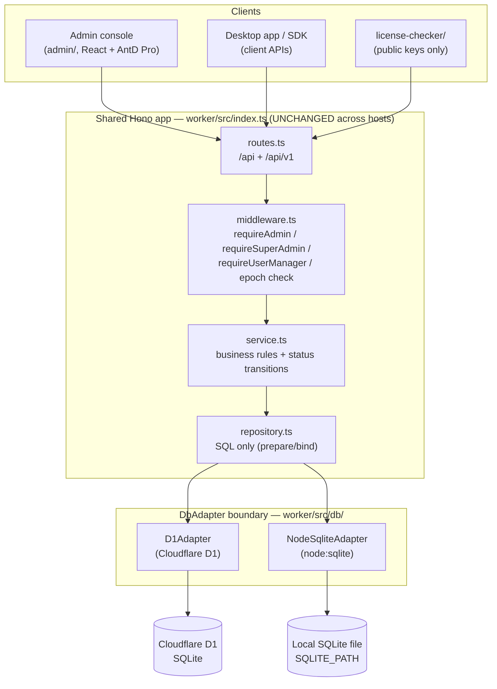
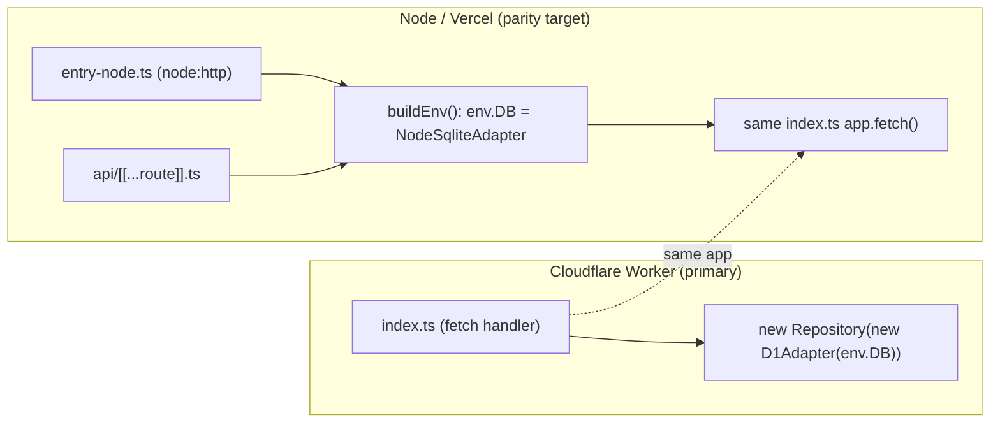
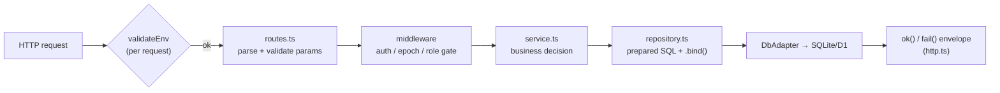
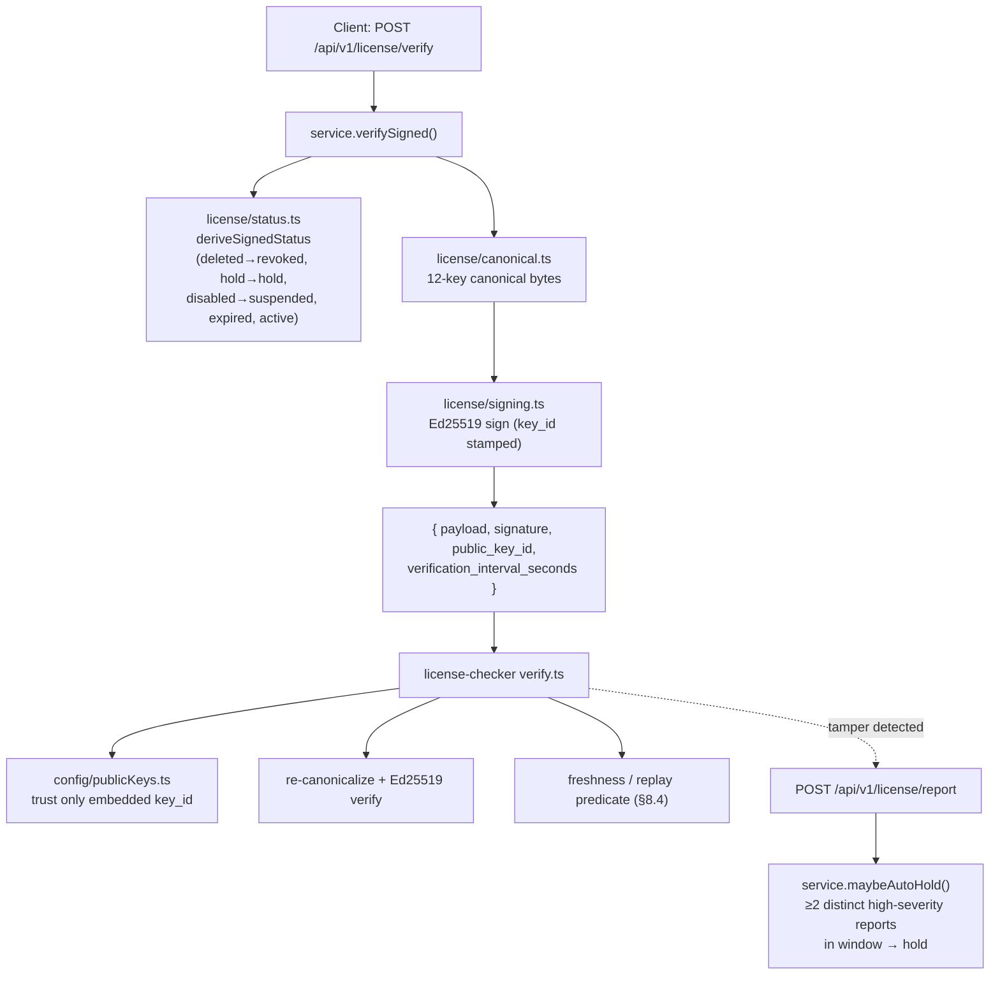
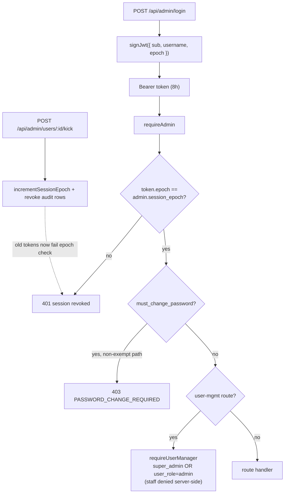
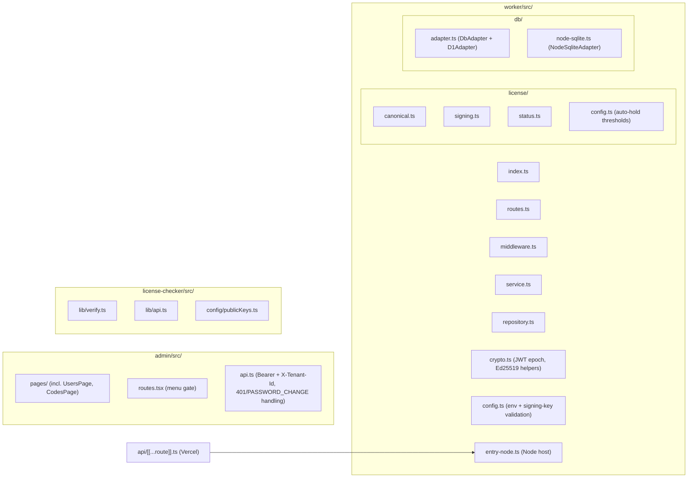

# Architecture — Phase 2 (Signed License + User Management + Dual Deployment)

This document is the Phase-2 structure visualization. It complements the
machine-generated graph in `graphify-out/` (`graph.json`, `graph.html`,
`GRAPH_REPORT.md`), which is regenerated with `graphify update . --force`
(graphify 0.9.67). The diagrams below are hand-maintained Mermaid, so they
survive without the graphify toolchain and highlight the Phase-2 additions:

- the signed-license surface (`worker/src/license/*`, `/api/v1`),
- the database-adapter boundary (`DbAdapter` + `D1Adapter` + `NodeSqliteAdapter`),
- admin/staff user management + JWT session-epoch kick-out,
- the second runtime (Node/Vercel entry point) alongside the Cloudflare Worker,
- the standalone `license-checker/`.

For the baseline Phase-1 layering see [ARCHITECTURE.md](ARCHITECTURE.md); this
file does not restate those rules, it extends them.

## System context — two runtimes, one app

The SAME Hono app (`worker/src/index.ts`) runs on two hosts. Only the host and
the database driver differ; routes, service, repository and crypto are
byte-identical. The Cloudflare Worker + D1 is the primary, durable target; the
Node/Vercel adapter is a functional-parity target backed by `node:sqlite`.

Host wiring:

## Request flow — route → service → repository (dependency direction fixed)

## Signed-license surface (`/api/v1`, `worker/src/license/*`)

A tampered field (status, expiry, server_time, …) breaks the signature, so the
checker shows "license failed to load" and reports the anomaly; corroborated
reports auto-hold the license. The private key never leaves the server; the
checker ships the PUBLIC key only.

## User management + stateless session kick-out (FEAT-002)

Roles (decision NU-2 Option C): the published login-role CHECK
(`super_admin` / `tenant_admin`) is untouched; the management role lives in an
additive `user_role` column (`admin` / `staff`). `super_admin` is the implicit
master manager.

## Migrations (schema source of truth)

`migrations/0001…0008` applied in filename order. Phase-2 added
`0008_add_admin_users_and_sessions.sql` (additive `session_epoch` + `user_role`
columns, `admin_sessions` table with `ON DELETE CASCADE`). Note: the graphify
SQL extractor (`tree_sitter_sql`) is not installed in this environment, so the
`.sql` files contribute no nodes to `graphify-out/graph.json`; the migration
list is authoritative in `migrations/` and `docs/DATABASE.md`.

## Module map (where things live)

See [DEPLOYMENT.md](DEPLOYMENT.md) for how each runtime is built and shipped.
